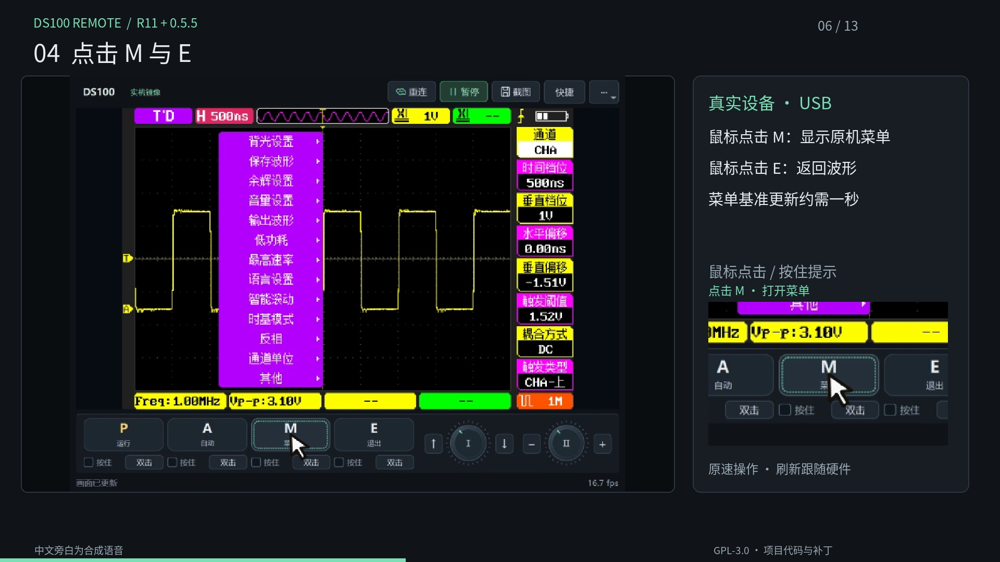

# DS100 Remote

**Attention：刷写第三方固件有损坏设备的风险，请谨慎使用。**

正点原子 DS100 的 Windows 上位机，以及基于官方 V4.8 的实验固件补丁。当前组合为 **R11 + 客户端 0.5.6.dev1**，已在硬件 2.4、Bootloader 4.0、LCD 0x9488 的一台设备上验证。

[下载发布包](https://github.com/HappyAny/DS100-Remote/releases/tag/v0.5.6-r11) · [观看使用方法与实机操作视频](https://github.com/HappyAny/DS100-Remote/releases/download/v0.5.6-r11/DS100-Remote-R11-Usage-1080p.mp4) · [操作说明](docs/usage.md) · [固件准备与升级](docs/firmware-release.md)

[](https://github.com/HappyAny/DS100-Remote/releases/download/v0.5.6-r11/DS100-Remote-R11-Usage-1080p.mp4)

视频展示真实 USB 设备响应。鼠标事件由程序内自动化执行；光标、点击圈和放大视图用于讲解。中文旁白为合成语音。开头与结尾均强调第三方固件刷写风险。

视频录制使用 0.5.5；发布的 0.5.6 增加了连接前的 USB 硬件身份校验，操作方法一致。

## 功能

- 480 × 320 原屏镜像，刷新跟随硬件。
- P/A/M/E、双拨轮、保持与双击、M/E 拨轮组合。
- 快捷按钮直接调节时基、量程和位置；支持排队与按住连续移动。
- 开机停在普通波形界面，连接数据线即可接入，无需切换 USB 菜单。
- 一键保存原始 PNG，查看设备保存的 CSV/BMP；离线演示始终标明测试数据。

原生实时波形采集和绝对运行／停止 API 尚未绑定。P 沿用原机运行／暂停切换规则。

## 下载与运行

发布页中的文件：

| 文件 | 用途 |
| --- | --- |
| `DS100-Remote-0.5.6-Windows.zip` | 免安装上位机，完整解压后运行 EXE，保留 `_internal` |
| `DS100-Firmware-R11-Patch-Windows.zip` | GPL 固件补丁与 Windows 本地镜像生成工具 |
| `DS100-Remote-0.5.6-r11-source.zip` | 对应源码、固件补丁与构建脚本 |
| `DS100-Remote-R11-Usage-1080p.mp4` | 使用方法和真实设备操作视频，含点击提示和中文旁白 |
| `DS100-Remote-R11-Usage-zh.srt` | 中文字幕 |
| `SHA256SUMS.txt` | 发布文件校验值 |

R11 需要客户端 **0.5.5 或更新版本**，旧客户端不支持新的按键确认格式。

固件发布的是补丁，不是重新许可的原厂完整镜像。生成工具下载固定的官方 V4.8 底包并在本地生成 `atk_dso.bin`，校验结果后才输出。也可以手动指定官方文件：

```powershell
python tools/prepare_firmware.py --base atk_dso_v_4_8.bin
```

生成的 R11 镜像 SHA-256：

```text
f5758123281d5cf96f991417447aa41652418af10de68fea6d2a142cf39942e7
```

生成工具不访问或刷写设备。升级步骤和已知风险见[固件说明](docs/firmware-release.md)。

## 从源码运行

Python 3.10 或更新版本：

```powershell
python -m pip install .
python run_app.py
```

离线演示：`python run_app.py --demo`。演示数据不代表实机性能。

Windows EXE 使用本机 PyInstaller 构建：

```powershell
python tools/build_windows_app.py --name DS100-Remote-Compact
```

固件补丁源码位于 `firmware/` 与 `experiments/`。本地补丁生成无需 ARM 编译器；重新编译研究候选需 `arm-none-eabi-gcc`，见[构建说明](docs/build.md)。

## 实测范围

完整软件检查 **273 项通过**。本轮视频录制覆盖菜单、四种保持组合、连续移动、通道双击和截图，结束后确认原设置恢复。实机与软件证据边界见[验证记录](docs/validation.md)。

M 菜单仍约需 1 秒，偶发画面重同步可能造成短暂停顿。USB 兼容策略使用 168 MHz；最高采集模式、测量准确性、全部硬件版本和长期可靠性未验证。没有完整 MCU Flash 或校准备份，也没有完成正式回退测试。

## 许可证

我们编写的上位机、固件补丁、构建工具及视频工程采用 **GPL-3.0-only**，见 [LICENSE](LICENSE)。

官方固件底包保留原权利人的权利，未被本项目重新许可，也不随发布包分发。字体与依赖分别保留自己的许可证，见 [第三方说明](THIRD_PARTY_NOTICES.md)。本项目与设备厂商无隶属关系。
