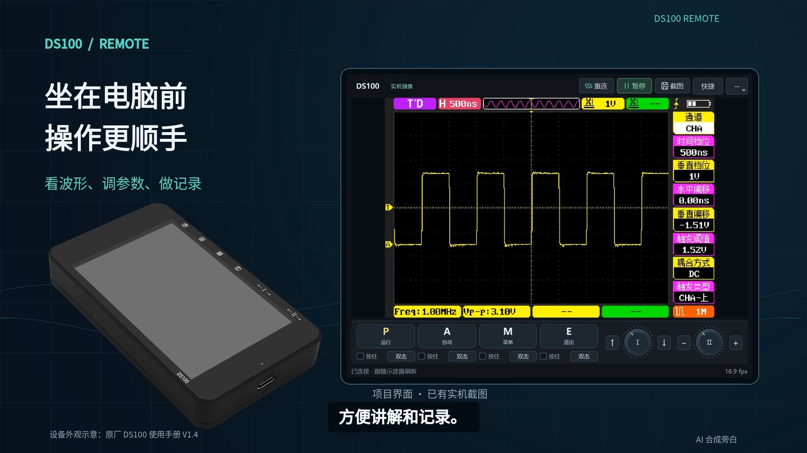

# 视频教程

**Attention：刷写第三方固件有损坏设备的风险，请谨慎使用。**

**[B站：给正点原子 DS100 做了个开源上位机](https://www.bilibili.com/video/BV1tHsW6kEsE/)** · `BV1tHsW6kEsE` · 约 8 分 07 秒。

视频从下载安装开始，介绍原屏镜像、四键双拨轮、快捷操作和原始截图。实机部分使用 R11 + Windows 客户端 0.5.6.dev1；鼠标事件由 Qt 自动化执行，画面附指针和点击提示，设备响应保持原速。旁白为 AI 合成。首尾均有风险提醒。

## 章节导航

| 时间 | 内容 |
| --- | --- |
| 00:00 | 第三方固件刷写风险 |
| 00:07 | 项目用途与功能预览 |
| 00:54 | 480 × 320 原屏镜像 |
| 01:20 | 实机：M 打开菜单、E 返回波形 |
| 01:39 | 下载 Windows 上位机与 R11 补丁工具 |
| 02:05 | 完整解压，保留 `_internal` |
| 02:32 | 本地生成 `atk_dso.bin` |
| 03:04 | 核对硬件与 Bootloader 版本 |
| 03:28 | A + P、复制文件与 M 升级流程 |
| 04:00 | 普通波形界面直接 USB 连接 |
| 04:24 | P/A/M/E、保持与双击 |
| 04:56 | 实机：按住 M 移动位置、按住 E 调时基和量程 |
| 05:20 | 时基和量程正负方向的含义 |
| 05:49 | 快捷按钮与连续移动 |
| 06:15 | 实机：连续移动、双击切通道、一键截图 |
| 06:37 | 480 × 320 PNG 与已保存 CSV/BMP |
| 07:07 | 刷新、等待与实验版本的使用范围 |
| 07:31 | 下载、源码与许可证 |
| 07:58 | 再次提醒刷写风险 |

时间为剪辑章节起点，平台转码后可能有约一秒差异。

## 配套文件

- [下载发布包](https://github.com/HappyAny/DS100-Remote/releases/tag/v0.5.6-r11)：Windows 上位机、R11 固件补丁生成工具和源码。
- [操作说明](usage.md)：保持键、方向与连续操作。
- [固件准备与升级](firmware-release.md)：生成校验与刷写风险。
- [验证记录](validation.md)：本次录制与既有检查的范围。

已经安装 R11 的设备无需为了观看教程而重刷。其他硬件版本尚未完成验证；刷新跟随设备状态，不保证固定帧率。

GitHub 发布资产中的 [早期 MP4 教程](https://github.com/HappyAny/DS100-Remote/releases/download/v0.5.6-r11/DS100-Remote-R11-Usage-1080p.mp4)约 4 分 12 秒，录制使用客户端 0.5.5，仍保留下载。它的字幕和视频源包对应早期版本，与本页 B 站版不同。

封面来自该视频的公开封面图。图中的设备外观示意引用原厂 DS100 使用手册 V1.4，原厂材料保留原权利；软件界面来自本项目实机截图。
